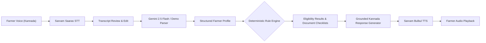

# Solution and Innovation — The Krishi Mitra Architecture

## 1. Architectural Philosophy: The Decoupled "AI Voice + Deterministic Engine" Pattern

Generic AI assistants attempt to perform both understanding and decision-making inside a single LLM prompt. In high-stakes domains like agricultural welfare, this approach inevitably produces hallucinations.

**Krishi Mitra establishes an architectural separation of concerns:**

1. **The Conversational Layer (Generative AI):**
   * Listens to the farmer's natural Kannada speech.
   * Extracts agricultural entities (location, land, crops, ownership, irrigation).
   * Generates empathetic, polite, culturally grounded Kannada explanations.
2. **The Decision Layer (Deterministic Rule Engine):**
   * Implemented strictly in Python with mathematical and Boolean operators.
   * Compares the extracted profile against official scheme requirements.
   * Produces verifiable, auditable four-state eligibility classifications.
   * **The LLM is never permitted to override the rule engine.**

---

## 2. Core Technological Innovations

### Innovation 1: Two-Way Kannada Voice Interaction Loop
* **Browser Microphone Stream:** Captures standard audio using modern `MediaRecorder` APIs with pulse animations and recording timers.
* **Sarvam Saaras Speech-to-Text:** Converts spoken Kannada into accurate text, with support for regional accents and code-mixed terms.
* **Transcript Review & Correction Modal:** Before dispatching to the AI, farmers can review, edit, or re-record their transcript, ensuring agency and preventing transcription errors.
* **Sarvam Bulbul Speech Synthesis:** Converts the generated Kannada response into natural, melodic audio voiced by the `"meera"` speaker profile for immediate audio playback.

### Innovation 2: Structured Profile Extraction with Conflict Provenance
* Extracts complex agricultural facts: District, Taluk, Village, Land Area, Measurement Units, Multiple Crops, Land Ownership, Season, Irrigation Source, and Assistance Needs.
* **Confidence Scoring & Provenance Tracking:** Every field tracks its confidence score, source of information (voice, user edit, clarification), and previous value history.
* **Negation and Self-Correction Handling:** Recognizes Kannada conversational corrections (e.g., *"3 ಎಕರೆ ಅಲ್ಲ 2 ಎಕರೆ"* $\rightarrow$ *not 3 acres, 2 acres*) and updates state without retaining stale data.

### Innovation 3: Ambiguous Term Clarification Guardrails
* Words like `"ಜೋಳ"` (*Jola*) are trapped by linguistic guards. Instead of guessing, Krishi Mitra triggers an adaptive clarification question asking whether the farmer grows *Sorghum / Jowar* (`ಬಿಳಿ ಜೋಳ`) or *Maize* (`ಮೆಕ್ಕೆಜೋಳ`).

### Innovation 4: Multi-State Deterministic Scheme Qualification
Unlike binary yes/no checkers, Krishi Mitra categorizes eligibility across four actionable states:
* `POTENTIALLY_SUITABLE`: All known mandatory criteria are satisfied.
* `INSUFFICIENT_INFORMATION`: Missing fields (e.g. land size or district) prevent a decision; triggers targeted adaptive questions.
* `REQUIRES_OFFICIAL_VERIFICATION`: Criteria that require government field inspections (e.g., Aadhaar bank linkage, RTC survey number match).
* `NOT_SUITABLE_BASED_ON_KNOWN_RULES`: Explicitly indicates which rule failed and why, preventing fruitless trips to government taluk offices.

### Innovation 5: Scheme Comparison & Document Readiness Checklists
* **Side-by-Side Comparison:** Compare subsidy percentages, benefit caps, and criteria between multiple schemes (e.g., PM-KISAN vs. Suvarna Bhumi).
* **Actionable Document Checklist:** Computes readiness percentages (0% to 100%) and itemizes documents the farmer has versus documents they still need to collect (Pahani/RTC, Aadhaar, Bank Passbook, Tenant Affidavit).

### Innovation 6: Zero-Dependency Offline Demo Fallback
* When cloud API keys (`GEMINI_API_KEY`, `SARVAM_API_KEY`) are unconfigured or disconnected, Krishi Mitra automatically falls back to an offline rule-based parser and audio chime synthesizer without crashing, ensuring uninterrupted hackathon demonstrations.

