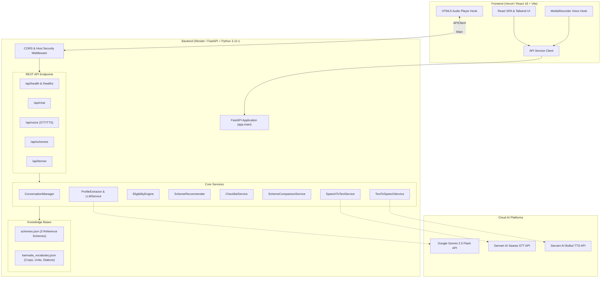

# System Architecture — Krishi Mitra

## 1. Architectural Topology

Krishi Mitra follows a modern client-server architecture deployed across cloud infrastructure with clean separation of presentation, business logic, deterministic rule evaluation, and external AI microservices.

---

## 2. Component Specifications

### 2.1 Frontend Component Hierarchy
* **`App.tsx`:** Master orchestrator managing bilingual state, active farmer profile, chat messages, audio player binding, and scheme modal toggles.
* **`Navbar.tsx`:** Displays branding, live connection indicator, AI model badge, and language switcher (`ಕನ್ನಡ` / `English`).
* **`QuickStartGuide.tsx`:** Onboarding component with step-by-step guidance and 1-click sample prompts.
* **`FarmerProfilePanel.tsx`:** Reactive card visualizing extracted fields (Crops, Land Size, Ownership, District, Irrigation) with confidence ratings and edit triggers.
* **`VoiceRecorderPanel.tsx`:** Real-time microphone recorder with audio waveform animation, recording timer, transcript review textarea, and text input fallback.
* **`ChatWorkspace.tsx`:** Conversational timeline displaying message bubbles, audio play buttons, and adaptive follow-up suggestions.
* **`SchemeList.tsx` & `SchemeCard.tsx`:** Filterable scheme cards categorized by eligibility status (`POTENTIALLY_SUITABLE`, etc.) with rule breakdown indicators.
* **`SchemeModal.tsx`:** Deep-dive modal containing scheme details, official portal links, comparison selectors, and document readiness checklists.
* **`SchemeComparisonModal.tsx`:** Multi-column matrix comparing benefits, eligibility criteria, and required papers.

### 2.2 Backend Service Architecture
* **`main.py`:** Application entrypoint initializing CORS, middleware, routers, and health-check endpoints.
* **`config.py`:** Pydantic `BaseSettings` reading environment variables with dynamic CORS array parsing.
* **`eligibility_engine.py`:** Pure deterministic evaluation engine executing Boolean rules over the farmer profile.
* **`scheme_recommender.py`:** Evaluates all scheme records against the farmer profile, computing match reasons and ordering recommendations.
* **`profile_extractor.py`:** Heuristic, regex, and dialect-aware extraction service that normalizes Kannada agricultural parameters.
* **`llm_service.py`:** Manages structured entity extraction and grounded conversational responses with Google Gemini 2.5 Flash.
* **`speech_to_text.py`:** Interfaces with Sarvam Saaras API with fallback to representative agricultural audio corpus.
* **`text_to_speech.py`:** Interfaces with Sarvam Bulbul API with fallback to synthetic WAV chime generation.
* **`scheme_source_service.py`:** Validates official government portal links and maintains real vs. synthetic scheme provenance.

---

## 3. Communication Protocols & Data Formats

* **Client $\leftrightarrow$ Server:** JSON over HTTPS REST APIs. Audio streams are uploaded as `multipart/form-data` and synthesized audio is delivered as base64-encoded `audio/wav` payloads.
* **Server $\leftrightarrow$ Gemini API:** Structured JSON mode via Google Gen AI Python SDK enforcing Pydantic schemas.
* **Server $\leftrightarrow$ Sarvam AI API:** HTTPS REST payloads with `api-subscription-key` authentication headers.

